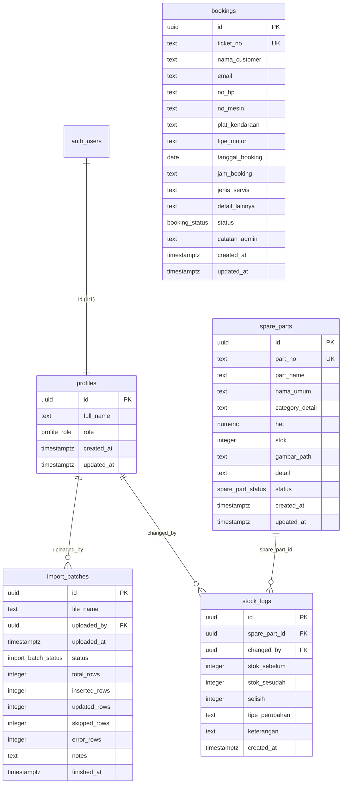

# Dokumentasi Database & Skema Supabase (PostgreSQL)

Dokumentasi arsitektur database, tabel, migrasi, dan konfigurasi keamanan Supabase untuk sistem AHASS AS Putra Rahmat Kuningan (AHASS 10870).

---

## 1. Arsitektur & Relasi Tabel (ERD)



---

## 2. Struktur Enum & Tipe Kustom

| Enum Name | Nilai / Value | Keterangan |
| :--- | :--- | :--- |
| `profile_role` | `'ADMIN'`, `'KEPALA_BENGKEL'`, `'CRM'` | Hak akses internal sistem |
| `spare_part_status` | `'ACTIVE'`, `'DISCONTINUE'`, `'UNKNOWN'` | Ketersediaan suku cadang |
| `import_batch_status` | `'PREVIEW'`, `'PROCESSING'`, `'COMPLETED'`, `'FAILED'` | Siklus hidup file Excel import |
| `booking_status` | `'PENDING'`, `'CONFIRMED'`, `'IN_PROGRESS'`, `'DONE'`, `'CANCELLED'` | Status proses servis pelanggan |

---

## 3. Daftar File Migrasi (`database/migrations/`)

| File | Deskripsi |
| :--- | :--- |
| [`001_initial_schema.sql`](file:///D:/Kerja%20Praktik/Web%20Bengkel%20As%20Putra/as-putra-system/database/migrations/001_initial_schema.sql) | Ekstensi `pg_trgm`, tabel `profiles`, `spare_parts`, `import_batches`, trigger timestamp, dan RLS awal. |
| [`002_category_counts_view.sql`](file:///D:/Kerja%20Praktik/Web%20Bengkel%20As%20Putra/as-putra-system/database/migrations/002_category_counts_view.sql) | View `category_counts` dengan grant publik untuk agregasi kategori instan. |
| [`003_add_partno_trgm_index.sql`](file:///D:/Kerja%20Praktik/Web%20Bengkel%20As%20Putra/as-putra-system/database/migrations/003_add_partno_trgm_index.sql) | Index GIN Trigram pada `spare_parts(part_no)` untuk pencarian nomor part instan. |
| [`004_create_bookings_table.sql`](file:///D:/Kerja%20Praktik/Web%20Bengkel%20As%20Putra/as-putra-system/database/migrations/004_create_bookings_table.sql) | Tabel `bookings`, penambahan role `CRM`, status enum booking, dan index trigram nama. |
| [`005_add_email_to_bookings.sql`](file:///D:/Kerja%20Praktik/Web%20Bengkel%20As%20Putra/as-putra-system/database/migrations/005_add_email_to_bookings.sql) | Kolom `email` pada tabel `bookings` untuk pengiriman tiket konfirmasi otomatis. |
| [`006_add_tipe_motor_to_bookings.sql`](file:///D:/Kerja%20Praktik/Web%20Bengkel%20As%20Putra/as-putra-system/database/migrations/006_add_tipe_motor_to_bookings.sql) | Kolom `tipe_motor` pada tabel `bookings`. |
| [`007_create_stock_logs_table.sql`](file:///D:/Kerja%20Praktik/Web%20Bengkel%20As%20Putra/as-putra-system/database/migrations/007_create_stock_logs_table.sql) | Tabel audit trail `stock_logs` untuk mencatat penyesuaian stok manual / import. |
| [`008_optimize_indexes_and_storage.sql`](file:///D:/Kerja%20Praktik/Web%20Bengkel%20As%20Putra/as-putra-system/database/migrations/008_optimize_indexes_and_storage.sql) | GIN Trigram index pada `bookings(plat_kendaraan)` dan konfigurasi bucket storage `spare-parts`. |

---

## 4. Cara Menjalankan Migrasi

### Opsi A: Setup Database Baru (1 Kali Eksekusi)
Gunakan file master [`schema.sql`](file:///D:/Kerja%20Praktik/Web%20Bengkel%20As%20Putra/as-putra-system/database/schema.sql):
1. Buka dashboard Supabase project Anda.
2. Masuk ke menu **SQL Editor**.
3. Buka tab baru, salin seluruh isi [`database/schema.sql`](file:///D:/Kerja%20Praktik/Web%20Bengkel%20As%20Putra/as-putra-system/database/schema.sql).
4. Klik **Run**. Seluruh tabel, view, trigram index, trigger, dan storage bucket akan otomatis terbuat secara idempoten.

### Opsi B: Menggunakan Supabase CLI
```bash
# Login & link project
supabase login
supabase link --project-ref <PROJECT_REF>

# Eksekusi migrasi yang belum terpasang
supabase db push
```

---

## 5. Keamanan & Kebijakan RLS (Row Level Security)

- **Backend Express**: Menggunakan `SUPABASE_SERVICE_ROLE_KEY` di server-side untuk bypass RLS secara terkontrol dan aman setelah validasi JWT/Role di middleware API.
- **Frontend / Client Publik**: Menggunakan `NEXT_PUBLIC_SUPABASE_ANON_KEY` yang dibatasi ketat oleh RLS:
  - `spare_parts`: Hanya dapat membaca (`SELECT`) suku cadang berstatus `ACTIVE`.
  - `category_counts`: Hanya dapat membaca agregasi hitungan kategori.
  - `bookings`, `stock_logs`, `profiles`, `import_batches`: Ditolak akses langsung dari klien anonim (`0 rows returned`).
- **Storage Bucket**: Bucket `spare-parts` diset `public: true` dengan policy SELECT publik agar gambar part dapat diakses cepat oleh browser pengguna melalui CDN Supabase.
