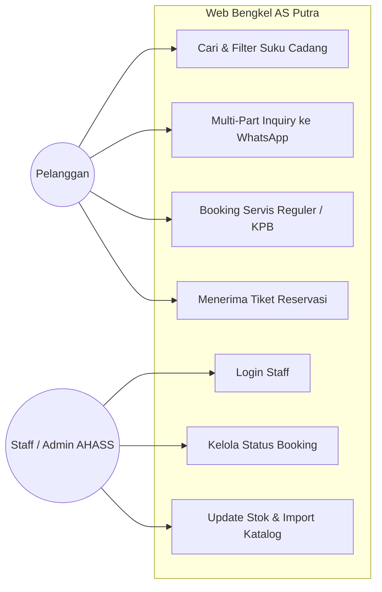
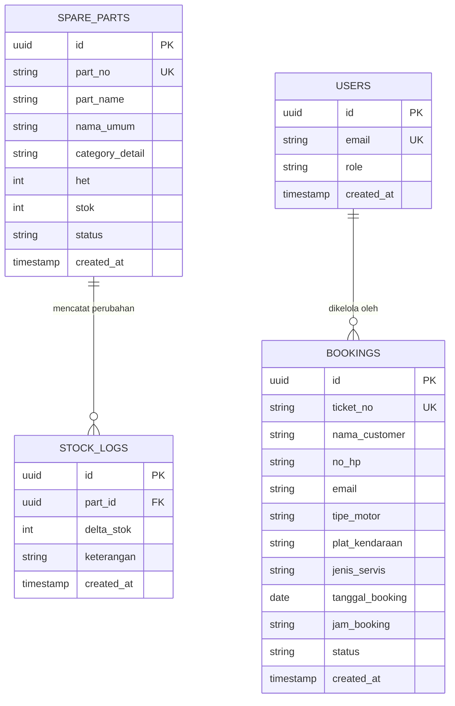

# DRAF LAPORAN KERJA PRAKTIK
**FAKULTAS ILMU KOMPUTER — UNIVERSITAS KUNINGAN**  
**TAHUN AKADEMIK 2026/2027**

---

### JUDUL USULAN
> **"PENGEMBANGAN SISTEM INFORMASI KATALOG SUKU CADANG DAN RESERVASI SERVIS MOTOR HONDA BERBASIS WEB PADA DEALER & AHASS 10870 AS PUTRA RAHMAT KUNINGAN"**

* **Tema KP FKOM UNIKU 2026/2027:** *“Pengembangan Teknologi, Desain dan Rekayasa Infrastruktur pada Dinas dan Industri”*  
* **Format Sitasi:** IEEE Citation Style  
* **Ketentuan Teknis:** Kertas A4 80 gr, Margin Kiri 4 cm, Kanan 3 cm, Atas 3 cm, Bawah 3 cm, Font Times New Roman 12 pt, 1.5 Spasi.

---

## BAB I: PENDAHULUAN

### 1.1 Latar Belakang Masalah
Dealer dan Bengkel Resmi Honda AHASS (Astra Honda Authorized Service Station) kode 10870 AS Putra Rahmat Kuningan merupakan salah satu pusat layanan perawatan kendaraan bermotor roda dua dan penyedia suku cadang asli Astra Honda Motor (AHM) terkemuka di Kabupaten Kuningan. Dalam operasional sehari-hari, bengkel melayani puluhan pelanggan servis rutin berkala (KPB), perbaikan berat, serta penjualan suku cadang eceran (*retail*).

Namun, observasi awal menunjukkan beberapa kendala operasional utama:
1. **Penumpukan Antrean Servis:** Pelanggan yang datang langsung (*walk-in*) sering mengalami waktu tunggu yang tidak terprediksi karena belum tersedianya sistem kuota slot jam servis online.
2. **Keterbatasan Akses Informasi Suku Cadang:** Pelanggan kesulitan mengetahui ketersediaan stok fisik dan kepastian Harga Eceran Tertinggi (HET) resmi sebelum datang ke bengkel. Pengecekan manual melalui telepon membebani petugas front-desk.
3. **Pemesanan Part Terpencar:** Saat pelanggan membutuhkan beberapa suku cadang sekaligus (misalnya paket servis oli, kanvas rem, dan busi), belum ada sarana pengelompokan kebutuhan (*multi-part inquiry*) yang terhubung langsung ke layanan pelanggan WhatsApp resmi bengkel.

Oleh karena itu, diperlukan pengembangan **Sistem Informasi Katalog Suku Cadang dan Reservasi Servis Berbasis Web** menggunakan teknologi *Next.js App Router*, *TypeScript*, dan basis data *Supabase PostgreSQL*.

### 1.2 Perumusan Masalah
Berdasarkan latar belakang tersebut, rumusan masalah dalam Kerja Praktik ini adalah:
1. Bagaimana merancang dan membangun sistem reservasi servis berkala dan reguler berbasis web dengan alokasi slot jam kedatangan otomatis pada AHASS AS Putra Rahmat Kuningan?
2. Bagaimana mengimplementasikan katalog suku cadang daring berkapasitas puluhan ribu data part AHM lengkap dengan transparansi harga HET dan status ketersediaan stok?
3. Bagaimana mengintegrasikan fitur penampung kebutuhan suku cadang (*multi-part inquiry*) yang langsung terhubung ke layanan pelanggan WhatsApp bengkel?

### 1.3 Tujuan dan Manfaat Kerja Praktik
#### 1.3.1 Tujuan Kerja Praktik
1. Mengembangkan platform reservasi online mandiri dengan tiket kode unik (`ASP-YYYYMMDD-XXXX`) guna mengurai antrean bengkel.
2. Membangun katalog pencarian cepat suku cadang AHM dengan kategori dan filter ketersediaan stok real-time.
3. Menerapkan fitur *multi-part consultation* yang mempermudah pelanggan berkonsultasi mengenai daftar kebutuhan part secara efisien.

#### 1.3.2 Manfaat Kerja Praktik
* **Bagi Mahasiswa:** Mengasah keterampilan rekayasa perangkat lunak modern (Next.js, Tailwind CSS, Supabase, RESTful API) pada studi kasus nyata industri.
* **Bagi Mitra (AS Putra Rahmat):** Meningkatkan efisiensi kerja Service Advisor, mengurangi antrean tidak teratur, serta mendongkrak penjualan suku cadang resmi AHM.
* **Bagi Pelanggan:** Menghemat waktu kunjungan servis dan menjamin kepastian harga resmi HET tanpa biaya tersembunyi.

### 1.4 Ruang Lingkup Pembahasan
Batasan sistem pada laporan Kerja Praktik ini meliputi:
1. Layanan reservasi mencakup Kupon Perawatan Berkala (KPB) dan Servis Reguler dengan batas slot jam operasional bengkel (Senin–Sabtu 08:00–16:00 WIB, Minggu 08:00–15:00 WIB).
2. Layanan kunjungan luar bengkel (*Service Visit*) dibatasi sebagai informasi kegiatan canvasing desa binaan dan instansi terjadwal, bukan layanan panggilan perorangan (*home service*).
3. Transaksi pembayaran langsung tidak diproses di website (transaksi diselesaikan di kasir bengkel atau via konfirmasi WhatsApp resmi).
4. Pengelolaan data stok dan verifikasi tiket dilakukan melalui Portal Admin khusus staf AHASS.

### 1.5 Metodologi Pengembangan Sistem
Metodologi yang digunakan adalah **Waterfall / SDLC Linier**:
1. **Analisis Kebutuhan (Analysis):** Observasi proses antrean fisik di bengkel dan struktur data master katalog suku cadang.
2. **Perancangan (Design):** Pemodelan proses bisnis menggunakan UML (Use Case, Activity Diagram) dan pemodelan data (Entity Relationship Diagram - ERD).
3. **Implementasi (Coding):** Frontend menggunakan Next.js (TypeScript, Tailwind CSS), Backend API menggunakan Express.js, dan penyimpanan cloud Supabase PostgreSQL.
4. **Pengujian (Testing):** Menggunakan metode *Black Box Testing* untuk memverifikasi fungsionalitas input dan respon sistem.

---

## BAB II: GAMBARAN UMUM PERUSAHAAN

### 2.1 Profil Singkat AHASS AS Putra Rahmat
* **Nama Instansi:** AS Putra Rahmat Motor (AHASS Kode 10870)
* **Kategori Usaha:** Dealer Resmi Sepeda Motor Honda & Bengkel Resmi Astra Honda Authorized Service Station (AHASS)
* **Alamat Fisik:** Jl. Siliwangi 126 Kasturi, Sebelah Utara Taman Cirendang, Kabupaten Kuningan, Jawa Barat 45518
* **Jam Layanan:**
  * Senin – Sabtu: 08:00 – 16:00 WIB
  * Minggu: 08:00 – 15:00 WIB

### 2.2 Visi dan Misi Perusahaan
* **Visi:** Menjadi pusat dealer dan bengkel perawatan sepeda motor Honda terdepan dan terpercaya di wilayah Kabupaten Kuningan dengan standar layanan prima Astra Honda Motor.
* **Misi:**
  1. Memberikan layanan servis profesional dengan mekanik bersertifikat resmi AHM.
  2. Menyediakan suku cadang asli 100% *Honda Genuine Parts* dengan harga HET transparan.
  3. Memanfaatkan teknologi informasi untuk mempermudah akses pelanggan terhadap layanan bengkel.

### 2.3 Struktur Organisasi Bengkel
Struktur operasional AHASS AS Putra Rahmat terdiri dari:
1. **Kepala Bengkel (Workshop Head):** Bertanggung jawab atas seluruh operasional bengkel dan pencapaian target.
2. **Service Advisor (SA):** Melakukan estimasi perbaikan motor, menerima tiket booking, dan berkomunikasi dengan konsumen.
3. **Kepala Mekanik & Tim Mekanik:** Melaksanakan servis dan penggantian part sesuai standar SOP pabrikan Honda.
4. **Part Counter Officer:** Bertanggung jawab atas stok gudang spare part, pencatatan masuk-keluar barang, dan konsultasi kode part.
5. **Front Desk / Customer Relation:** Mengelola administrasi pendaftaran dan pesan pelanggan.

---

## BAB III: LANDASAN TEORI

Teori yang menjadi rujukan dalam penyusunan laporan ini meliputi:
1. **Sistem Informasi Manajemen Bengkel:** Pengertian dasar sistem informasi terintegrasi dalam manajemen antrean dan inventaris.
2. **Next.js & App Router:** Kerangka kerja React modern yang mendukung *Server-Side Rendering* (SSR), *Server Components*, dan optimasi SEO lokal.
3. **TypeScript:** Bahasa pemrograman bertipe ketat (*strictly-typed*) untuk meminimalkan *runtime error*.
4. **Tailwind CSS:** Framework CSS *utility-first* untuk antarmuka responsif dan konsisten.
5. **Supabase & PostgreSQL:** Basis data relasional berbasis SQL dengan kapabilitas *Row Level Security* (RLS) dan *real-time indexing*.
6. **Black Box Testing:** Pengujian fungsional perangkat lunak tanpa memeriksa struktur kode internal, guna memastikan output sesuai spesifikasi kebutuhan.

---

## BAB IV: ANALISIS DAN PERANCANGAN SISTEM

### 4.1 Analisis Sistem yang Berjalan (SWOT)
* **Strengths:** Dukungan reputasi nama besar Honda dan suku cadang asli AHM melimpah.
* **Weaknesses:** Pendataan booking servis sebelumnya masih berbasis catatan fisik atau pesan chat manual tanpa kuota slot jam otomatis.
* **Opportunities:** Tingginya penetrasi pengguna *smartphone* di Kuningan yang menghendaki kepraktisan cek harga dan booking tanpa antre.
* **Threats:** Persaingan dengan bengkel umum yang menawarkan kecepatan pengerjaan meski suku cadang non-original.

### 4.2 Perancangan UML (Unified Modeling Language)

#### Use Case Diagram


#### Entity Relationship Diagram (ERD)


---

## BAB V: HASIL, PEMBAHASAN DAN PENGUJIAN

### 5.1 Implementasi Antarmuka Pengguna
1. **Halaman Beranda (`/`):** Menyajikan identitas resmi AHASS 10870, lokasi Google Maps terverifikasi, jam operasional, dan pencarian cepat.
2. **Katalog Suku Cadang (`/katalog`):** Menampilkan lebih dari 44.000 part asli Honda lengkap dengan harga HET dan status ready/inden.
3. **Drawer Multi-Part WhatsApp:** Memungkinkan user memilih lebih dari 1 barang, mengubah quantity, dan mengirimkan pesan rekapitulasi ke nomor WA AHASS dalam 1 kali klik.
4. **Formulir Booking Servis (`/booking`):** Pilihan cerdas servis KPB (Standard / Premium) atau servis reguler dengan pembatasan jam dinamis.

### 5.2 Tabel Pengujian Black Box Testing (UAT)

| No | Modul / Skenario Uji | Masukan (Input) | Hasil yang Diharapkan | Hasil Pengujian | Kesimpulan |
|---|---|---|---|---|---|
| 1 | Pencarian Suku Cadang | Kata kunci: `"kampas rem"` | Sistem menampilkan daftar kampas rem dengan harga HET dan stok | Sesuai | Valid |
| 2 | Filter Ketersediaan | Mengaktifkan saklar *"Hanya yang ready"* | Sistem hanya menampilkan barang dengan stok > 0 | Sesuai | Valid |
| 3 | Multi-Part WA Inquiry | Klik "+ List" pada 2 part berbeda | Barang masuk ke drawer, total estimasi terhitung, URL pesan WA otomatis terformat | Sesuai | Valid |
| 4 | Pemilihan Slot Hari Minggu | Memilih tanggal hari Minggu | Slot jam 15:00 otomatis dinonaktifkan (tutup jam 15:00 WIB) | Sesuai | Valid |
| 5 | Booking Servis Sukses | Mengisi identitas lengkap, motor, dan jadwal | Sistem mencetak kode tiket unik (`ASP-YYYYMMDD-XXXX`) dan opsi kirim ke WA | Sesuai | Valid |
| 6 | Login Petugas Admin | Input email dan password staf terdaftar | Mengarahkan ke `/admin/bookings` dan menampilkan daftar reservasi | Sesuai | Valid |

---

## BAB VI: KESIMPULAN DAN SARAN

### 6.1 Kesimpulan
1. Sistem informasi berhasil dibangun menggunakan Next.js App Router dan Supabase PostgreSQL untuk mengakomodasi kebutuhan reservasi online dan katalogisasi suku cadang resmi AHM.
2. Fitur alokasi slot kedatangan mampu membagi kapasitas beban kerja bengkel secara teratur sehingga mengurangi penumpukan fisik di ruang tunggu AHASS AS Putra Rahmat Kuningan.
3. Fitur *multi-part inquiry* memudahkan konsumen mengkonsultasikan paket penggantian part secara langsung ke saluran WhatsApp resmi dengan rekapitulasi yang terstruktur.

### 6.2 Saran
1. Pengembangan selanjutnya dapat menambahkan integrasi payment gateway untuk pemesanan suku cadang inden langsung via website.
2. Menambahkan fitur broadcast WhatsApp otomatis menggunakan WhatsApp Business API resmi ketika status pengerjaan motor pelanggan telah selesai diservis oleh mekanik.

---

## DAFTAR PUSTAKA (Contoh Standar IEEE)
```text
[1]  Astra Honda Motor, "Pedoman Pelayanan dan Standarisasi AHASS," PT Astra Honda Motor, Jakarta, Tech. Rep., 2024.
[2]  R. Pressman and B. Maxim, Software Engineering: A Practitioner's Approach, 9th ed. New York, NY, USA: McGraw-Hill Education, 2020.
[3]  Next.js Documentation, "Next.js App Router Documentation," Vercel, 2026. [Online]. Available: https://nextjs.org/docs.
[4]  Supabase, "PostgreSQL Database and Realtime Security Guidelines," Supabase Inc., 2025. [Online]. Available: https://supabase.com/docs.
[5]  I. Sommerville, Software Engineering, 10th ed. Boston, MA, USA: Pearson, 2016.
```
