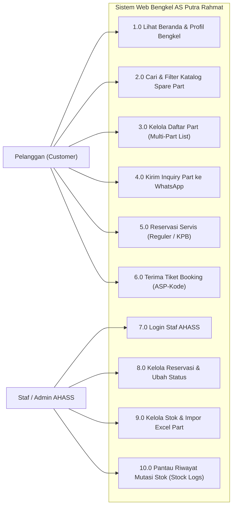
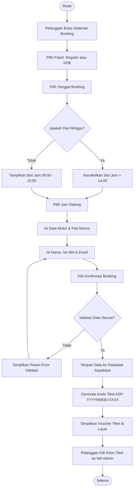
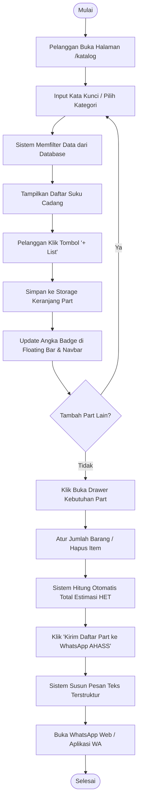
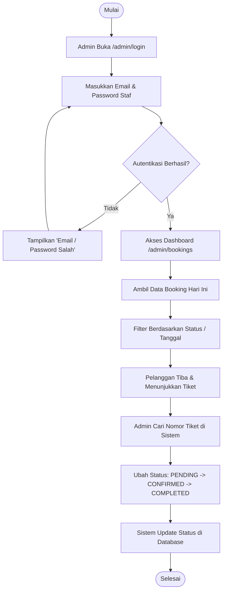
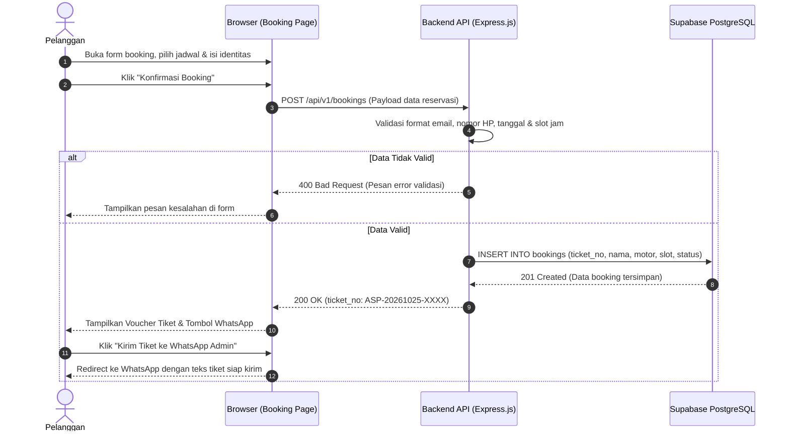
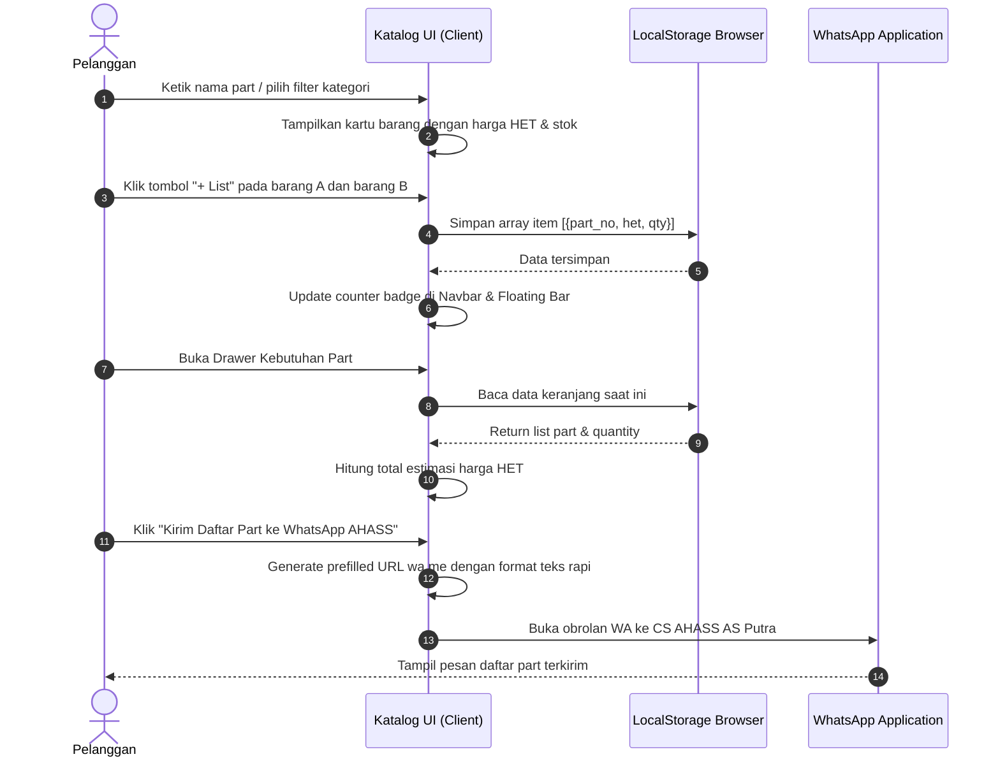
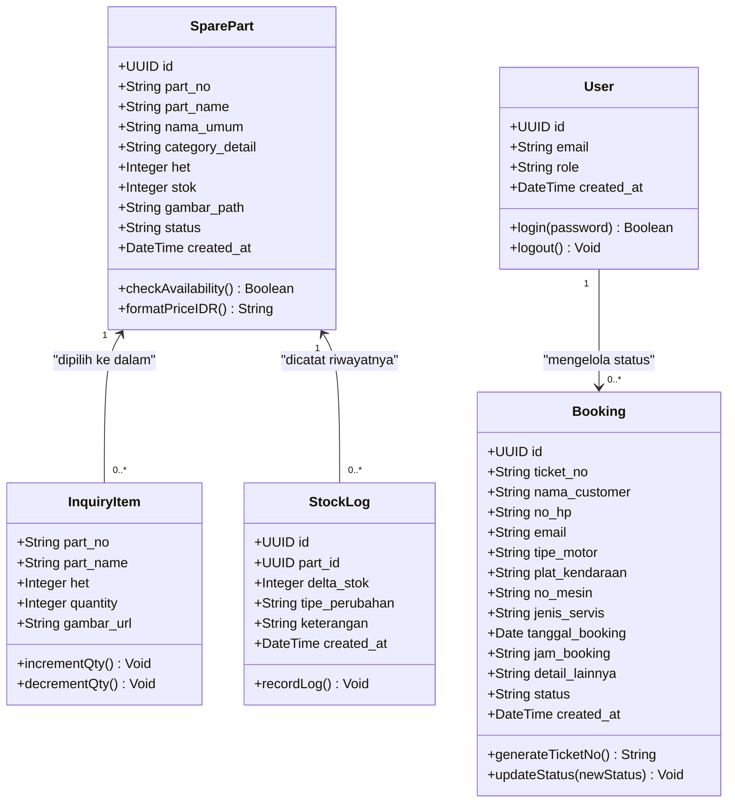
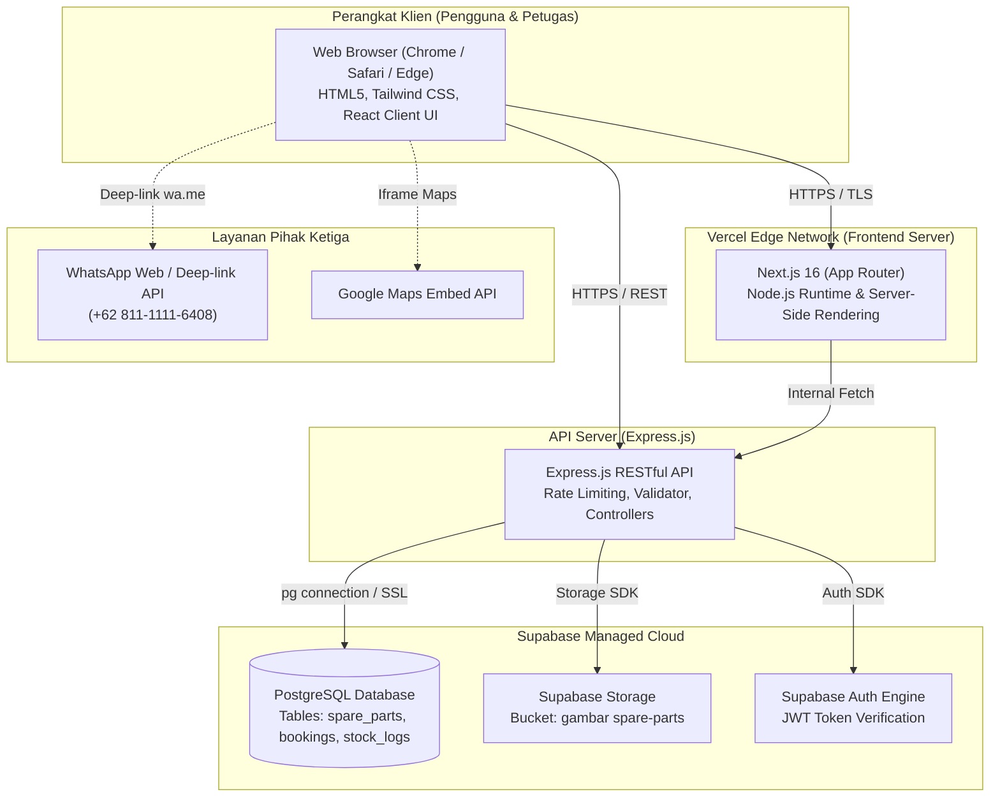

# DOKUMENTASI LENGKAP UML (UNIFIED MODELING LANGUAGE)
**SISTEM INFORMASI KATALOG SUKU CADANG & RESERVASI SERVIS MOTOR HONDA**  
**AHASS 10870 AS PUTRA RAHMAT KUNINGAN**  
*Materi Bab IV Laporan Kerja Praktik — FKOM Universitas Kuningan*

---

## 1. USE CASE DIAGRAM

### 1.1 Diagram Use Case Sistem
Diagram use case memodelkan interaksi antara dua aktor utama: **Pelanggan (Customer)** dan **Staf / Admin AHASS**.

---

### 1.2 Deskripsi & Skenario Use Case Utama

#### Skenario 1: Reservasi Servis Online (UC 5.0)
* **Aktor Utama:** Pelanggan
* **Kondisi Awal (Pre-condition):** Pelanggan membuka halaman `/booking`.
* **Kondisi Akhir (Post-condition):** Tiket booking tersimpan di database dan kode tiket unik (`ASP-YYYYMMDD-XXXX`) berhasil diterbitkan.
* **Alur Utama (Main Flow):**
  1. Pelanggan memilih jenis servis: Servis Reguler (Ganti Oli, CVT, Servis Lengkap) atau KPB (Kupon Perawatan Berkala).
  2. Pelanggan memilih tanggal rencana kedatangan.
  3. Sistem memeriksa hari: jika hari Minggu, sistem menonaktifkan slot di atas jam 14:00; jika hari yang sama (*today*), sistem mematikan jam yang telah terlewat.
  4. Pelanggan memilih slot jam yang tersedia.
  5. Pelanggan memasukkan data kendaraan (tipe motor, nopol, no mesin).
  6. Pelanggan mengisi data pemilik (nama lengkap, nomor WhatsApp, email).
  7. Pelanggan mengklik tombol "Konfirmasi Booking".
  8. Sistem memvalidasi input, membuat tiket unik, dan menampilkan voucher tiket di layar serta opsi kirim tiket langsung ke WhatsApp Admin.
* **Alur Alternatif (Alternative Flow):**
  * *4a. Slot penuh atau jam tidak valid:* Sistem menampilkan peringatan dan meminta pelanggan memilih jam lain.
  * *7a. Format email atau nopol keliru:* Sistem menampilkan pesan validasi *inline* berwarna merah.

---

#### Skenario 2: Cari & Konsultasi Multi-Part WA (UC 3.0 & UC 4.0)
* **Aktor Utama:** Pelanggan
* **Kondisi Awal:** Pelanggan membuka halaman `/katalog`.
* **Kondisi Akhir:** Pesan daftar suku cadang tersusun rapi dan terkirim ke WhatsApp AHASS.
* **Alur Utama:**
  1. Pelanggan mencari suku cadang via *search bar* atau filter kategori.
  2. Pelanggan mengklik tombol "+ List" pada suku cadang yang diinginkan.
  3. Sistem menyimpan item ke *local state* dan menampilkan *Floating Bar* di pojok kanan bawah.
  4. Pelanggan membuka laci (*Drawer*) daftar part, lalu mengatur jumlah (*quantity*) kebutuhan.
  5. Pelanggan mengklik "Kirim Daftar Part ke WhatsApp AHASS".
  6. Sistem menyusun teks pesan terformat otomatis berisi nama part, kode part, kuantitas, dan total estimasi HET, lalu membuka aplikasi WhatsApp.

---

## 2. ACTIVITY DIAGRAM

### 2.1 Activity Diagram: Alur Reservasi Servis Online
Menjelaskan langkah kerja sistem dari pemilihan tanggal dan slot hingga tiket berhasil terbit.

---

### 2.2 Activity Diagram: Alur Pencarian & Multi-Part WhatsApp
Menjelaskan cara kerja keranjang sementara suku cadang hingga menghasilkan pesan WhatsApp rekapitulasi.

---

### 2.3 Activity Diagram: Alur Pengelolaan Booking oleh Staf Admin
Menjelaskan aktivitas petugas servis di bengkel saat mengonfirmasi kedatangan pelanggan.

---

## 3. SEQUENCE DIAGRAM

### 3.1 Sequence Diagram: Reservasi Servis Online
Menunjukkan urutan pertukaran pesan antar-objek (*Browser UI*, *Next.js Server / API*, dan *Supabase DB*).

---

### 3.2 Sequence Diagram: Pencarian Part & Multi-Part WhatsApp
Menunjukkan siklus pengelolaan keranjang konsultasi part tanpa melibatkan pembayaran rumit.

---

## 4. CLASS DIAGRAM

Class diagram memodelkan struktur data dan operasi objek pada sistem:

---

## 5. DEPLOYMENT DIAGRAM

Diagram deployment menggambarkan arsitektur fisik tempat sistem berjalan:

---

> [!TIP]
> **Petunjuk Memasukkan ke Microsoft Word:**
> 1. Salin kode Mermaid di atas ke visualizer seperti [Mermaid Live Editor](https://mermaid.live) atau gunakan extension VS Code/Antigravity untuk mengekspornya menjadi format gambar **PNG/SVG**.
> 2. Tempelkan gambar ke dokumen laporan Bab IV dengan penomoran standar, misalnya:  
>    * *Gambar 4.1 Use Case Diagram Sistem Web AHASS AS Putra*  
>    * *Gambar 4.2 Activity Diagram Alur Booking Servis*  
>    * *Gambar 4.3 Sequence Diagram Reservasi Servis*  
>    * *Gambar 4.4 Class Diagram Sistem*  
>    * *Gambar 4.5 Deployment Diagram Sistem Informasi*
